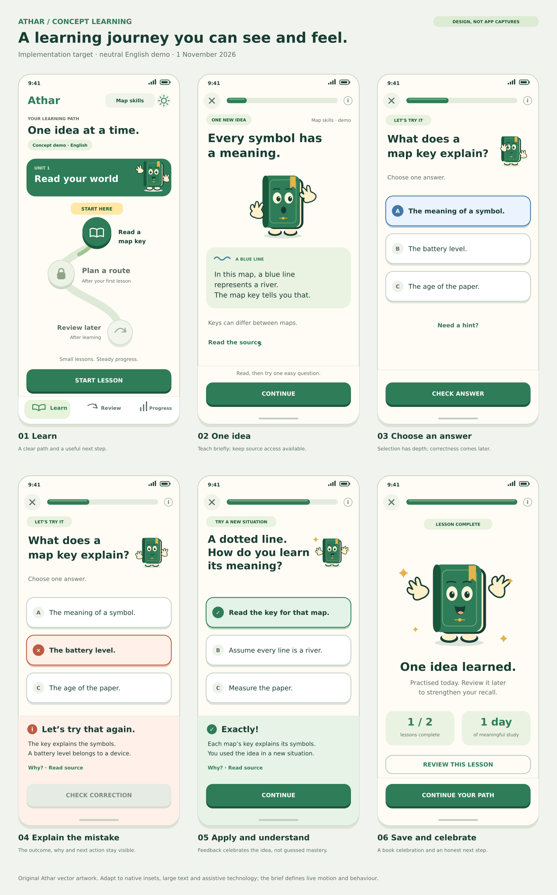

# Athar: correct the delivered concept experience

Prepared 1 November 2026. Authorized corrective implementation brief for local Codex in the existing native Android repository. This document and its visual reference specify work to implement; their existence is not evidence that the APK has changed.

## Outcome and authority

Musab installed the completed debug milestone and reported that the interface still looked like the previous build, with none of the expected Duolingo-like experience. Review confirmed a default-entry defect and substantial visual shortcomings. Musab authorized the corrections: make the concept experience normally accessible, redesign one complete learning journey, implement expressive book and interface motion, and verify an ordinary installation and upgrade.

Implement the corrections through to a verified APK using the existing development cycle. Do not stop after a plan, a mockup, changing the default pack, or displaying a book. Continue across the three bounded implementation tasks below without asking Musab to reauthorize routine branches, checks, commits, pushes or eligible merges. Do not invent unrelated features.

Read `AGENTS.md`, `Athar_Development_Cycle_Prompt.md`, `Elm_Project_Blueprint.md`, `docs/STATUS.md`, `docs/CONTENT.md`, the original `Athar_Concept_Learning_Mimic_Codex_Brief.md`, and this brief. This approved concept-first direction supersedes the old audio-first entry proposal where they conflict. Keep the native Kotlin/Compose, Room and Media3 implementation. Preserve the functioning content contract, independent-retention rules and durable session engine.

ChatGPT's role remains product direction, handoff and evidence review; local Codex implements and verifies in the user's workspace. This handoff is directly available in Git and does not require a ChatGPT document session.

## Verified problem, with reproducible evidence

The reviewed baseline is `701aa18858601364af3a21bfa0e8b9feff6e88fc`, after PR #22. Inspect current main and preserve anything newer; never reset the workspace to this checkpoint. No open PRs were returned during preparation of this brief.

The exact device-artifact APK from [main run 41324766567](https://github.com/darkest-pearl/Athar/actions/runs/41324766567) was inspected. Its SHA-256 was `2246db05a25b3c825d2d6aba0c0f1cc2f452221c550596d9ec68b7cd7f700700`, matching the reported deliverable. These findings therefore concern the reported APK, not a guessed older binary.

| Finding at the reviewed commit | Consequence | Required correction |
| --- | --- | --- |
| `ContentRepository.load()` opens `fixture-pack.json` by default, then prefers an existing `active-pack.json` (approximately lines 390-394). | A normal fresh install starts with the old App controls course. | The concept demo must be the default learning experience for a fresh development install. |
| The APK contains both `assets/fixture-pack.json` and `assets/concept-fixture-pack.json`. The former is schema 1 with no authored activities. | Packaging the new fixture did not make it the normal experience. | Fix explicit course selection/loading, not just asset inclusion. |
| `MainActivity.openLesson()` enters the Concept route only when `lesson.activities` is nonempty (approximately lines 224-248). | The old default course continues into the old lesson UI. | Ensure the normal launch-to-lesson route actually reaches the new flow. Preserve legacy lesson compatibility. |
| `scripts/verify_concept_lesson.py`, approximately lines 45-49, pushes the concept fixture with ADB and copies it into `files/active-pack.json` using `run-as` before recording. | The same APK was tested in a specially prepared content state that a normal install did not reach. | The primary acceptance journey must start from the delivered app's ordinary launcher and visible controls, with no private pack injection. |
| The new-flow screenshots retain large serif dashboard headings, a simple connected-circle list, conventional radio options and much of the earlier styling. | The requested product transformation is not apparent even in the test-prepared flow. | Implement the screen and component design below, then inspect real renders against the supplied targets. |
| In `concept-first-feedback.png`, the correction panel starts below the choices; most explanation is below the visible viewport. | Feedback can look absent until the user discovers scrolling. | Show the answer outcome, short explanation and next action together in a visible feedback dock. |
| `BookCompanion.kt` contains real layered drawing and event animation; the recording includes changing hand positions and completion movement. | Saying that no animation code exists would be inaccurate. The problem is accessibility, prominence and overall execution. | Refine and integrate this rig and the surrounding UI; preserve good lifecycle and reduced-motion behaviour. |

Use those pinned files and the prior device artifact as the before evidence. Reproduce the default-launch defect before fixing it. Existing screenshots are useful baseline evidence, not visual approval. The 45 draft English concepts and 90 questions remain Undecided; none of this authorizes their publication.

## Concrete visual reference

Open [the six-screen vector reference](docs/design/concept-ui-targets.svg). It shows Learn, teaching, selected supported practice, incorrect feedback, correct application feedback, and completion at a 390 x 844 logical-pixel design size. These are new design targets, not screenshots of an implemented app and not a claim of measured Duolingo fidelity. Use real dp/sp, system insets and responsive layout in Android.

Implement this visual direction autonomously; do not pause for a mockup approval. Treat the reference as the composition and component target. Native typography, accessibility and content length take precedence over literal pixel matching. If an adaptation is necessary, record the specific reason and show the resulting screen.

### Design decisions

- Keep Athar's original warm-white, forest-green, mint and amber palette. Use a friendly sans-serif interface with strong prompt hierarchy. Remove oversized serif dashboard styling from this new journey. Keep proper Ethiopic/Arabic font fallback and direction handling; new copy is English first and belongs in resources, not hard-coded UI strings.
- Make **Learn** the primary destination, with **Review** and **Progress** as the other bottom destinations. Learn combines the useful next action and course path; avoid making people move between duplicate Today and Path screens to find their lesson. Settings is a secondary top control. Preserve old route restoration by mapping former Today/Path destinations to Learn; do not discard saved lesson or path position.
- Show a compact course selector, a small development-demo label and an ordered, staggered path with a visible connector. Clearly distinguish completed, current, available and prerequisite-locked lessons. Use icons and labels as well as colour. Offer a clear current-lesson action and an honest due-review indicator. Do not fabricate additional lessons or due reviews to fill the artwork.
- Use original book illustrations to support the path and lesson. Keep the strongest celebration at completion. Do not introduce human avatars, an owl, copied Duolingo artwork/fonts/branding, hearts that block practice, payments, leaderboards, accounts, new audio processing or backend work.
- Use restrained surface depth: answer tiles and primary buttons have a lower edge and a clear pressed face, rather than treating every interaction as a flat form. Use rounded rectangles, not generic pill-shaped radio forms for every answer. Selected is visually distinct from correct.
- Keep lesson navigation focused: close control, compact progress, one activity, and a stable bottom action area. App tabs disappear during teaching, questions, feedback and completion. Avoid repeating the full lesson title, objective and stage hierarchy above every question.

### Native component specifications

| Component | Proposed target | Behaviour |
| --- | --- | --- |
| Main background / text | Warm white `#FFFCF5`; ink `#183C33` | Readable, calm surface; verify contrast for actual sizes. |
| Primary / lower button edge | Green `#2E7C58` / dark green `#19573B` | White label; roughly 5 dp depth; visible pressed state. |
| Selection / success / correction | Blue-tinted selection; mint success; warm red correction | Include an icon and explicit text; never depend on colour alone. |
| Screen spacing | 20-24 dp side gutters; 8 dp spacing rhythm | Reduce decorative gaps before pushing answers or feedback offscreen. |
| Primary action | At least 52-56 dp high, full usable width | Stable bottom dock above safe insets; disabled until input is valid. |
| Answer tile | At least 64 dp high; 16-20 dp corner radius | Whole tile selects. Use a letter/check/cross indicator with accessible selected state. Grow for wrapping text. |
| Lesson prompt | Approximately 24-28 sp, strong weight | First reading priority. Do not shrink text to force the screenshot. |
| Book | About 120-150 dp for teaching; 64-88 dp near a question; 170-200 dp at completion | Use a compact prompt row where suitable; avoid a large blank mascot row above every question. |
| Feedback dock | Outcome, short why, source access, then Check correction/Continue | Visible on submission at standard text size. Expand long source material separately. |
| Touch/accessibility | Minimum 48 dp targets; semantic roles/state | Correct focus order, meaningful labels, text that scales and no decorative focus traps. |

These dimensions and animation timings below are Athar design targets, not measured private Duolingo specifications. Use the prior brief's observed Mimic patterns as the learning/interaction reference. Apply its pattern-extraction/adaptation approach; do not restart a lengthy research exercise in place of implementation.

## Task 1: correct the actual entry and upgrade behaviour

Suggested branch: `fix/concept-demo-entry`, from synchronized main after this handoff PR is integrated.

1. Reproduce launch from the installed baseline without a test-created `active-pack.json`. Record the displayed course, start action and actual lesson route.
2. Make the bundled schema-2 concept fixture the fresh-development-install default. Keep it plainly labelled as a neutral English concept demo. It must open through normal navigation offline, with no manual JSON import, shell command, secret setting or restart trick.
3. Existing installations without an explicitly imported pack should naturally reach the new default while all old controls-course completions/answers remain stored under their existing identities. Do not rewrite historical IDs, question versions or immutable content just to transfer credit to the new course.
4. Preserve an existing valid imported pack and its selection. Add a plainly visible course/demo choice on Learn so that an upgraded installation can open the concept demo and return to its existing course. This is an ordinary course selection, not a developer-only switch.
5. Switching to a demo must not overwrite or lose the imported pack. Persist the selected course/source and retain the original validated bytes/identity as needed. Use the smallest durable storage change that supports switching and restarting; do not build a general marketplace or unrequested catalog. Keep identity-ledger checks, atomic writes, invalid-import behaviour and course-scoped progress intact.
6. Return to the selected course and its appropriate saved lesson/path position after process death. Pending sessions belonging to another course must not be silently resumed in the current course.
7. Keep the legacy fixture available for compatibility checks without keeping it as the new default. Explain where it is accessible. Update stale documentation that describes it as the current default.
8. Verify a fresh install and an in-place upgrade in isolated QA. Include at least one saved legacy completion and one pending session before upgrade, then prove those records are still available afterward. Also cover an installation with an imported active pack and switching away/back.

Do not clear app data, uninstall the user's app, replace their recording folder or remove an imported pack to make a demonstration pass. Check signing and applicationId continuity for upgrade testing. If different debug signing keys prevent installing an update, build the baseline and candidate using the same isolated QA key, and distinguish that test from a real user's signing compatibility. Never commit or upload private keystores; do not present uninstall-and-reset as the fix.

Acceptance: a person installing the delivered APK reaches an animated concept lesson through the visible app controls. A person upgrading can find that same demo without sacrificing their previous course or data. A default-asset assertion alone is insufficient.

## Task 2: implement the complete visual and motion journey

Suggested branch: `feat/concept-learning-experience`, from synchronized main after Task 1 is merged and verified.

Implement the six target screens and shared components as a coherent native journey. Carry the shared answer/feedback language into due Review so the experience does not abruptly fall back to a different form. Preserve the already-working review qualification and saved-session behaviour.

### Required screen states

| Screen/state | Required experience | Check before calling it done |
| --- | --- | --- |
| Learn | Selected course, compact status, illustrated ordered path, current lesson and genuine due-review access | The current action is obvious on launch; next/current/completed/locked are distinguishable; selected node reveals a useful lesson preview. |
| Teaching | One short concept, expressive book and a compact callout or concept card; source access is secondary | The learner can read the idea before the first easy question. Optional audio never blocks the text-only route. |
| Question, no choice | One prompt, three readable answer tiles, hint access, disabled Check | At 390 x 844 dp and fontScale 1.0 the short fixture prompt, all three options and action are visible together. |
| Question, selected | Clear selected state, enabled Check and visible press feedback | Selection is blue/neutral, not an unearned correct/green result. Repeated taps cannot submit multiple answers. |
| Incorrect | Reassuring book, explicitly wrong first response, correct idea and short explanation in the dock | Feedback is immediately visible; the answer is not hidden below a long list. A correction remains separate from the first answer and later recall. |
| Correct | Happy book, explicit confirmation and short explanation, then Continue | Do not auto-advance before the learner can read. Do not describe one easy response as mastery. |
| Mistake replay | Clearly labelled revisit after intervening work | Preserve its durable separate identity and practice classification. Do not turn it into independent retention. |
| Completion | Expressive book celebration, truthful saved result, next lesson/path and optional repeat | Lesson data is committed before cosmetics. Do not show a retained/ mastered label without supporting later evidence. |
| Updated Learn / due Review / Progress | Current node updates; review uses the same clear tiles and feedback; Progress separates practice/correction/later recall | State survives reopening and course changes. No fake due date or reward is manufactured in the learner flow. |

For a short question at standard phone/text size, all choices and the current action should fit. At large text, very small displays or landscape, allow intentional scrolling with the prompt/state understandable and the action reachable. Long explanation/source text may expand into a sheet or secondary panel with a clear return. The concise answer outcome and essential correction must remain discoverable immediately, without relying on a QA script to scroll to prove that some node exists.

Reserve a visible feedback region in the action dock or use an equivalent native pattern that prevents overlap. Keep all three states distinguishable: selected answer, first committed result and subsequently corrected result. Do not erase the immutable first response to achieve cleaner styling.

The current engine can append replay work after an error. Do not let its changing denominator make the progress bar move backwards or make completion suddenly look like a different unrelated five-stage lesson. Represent new replay work clearly and keep displayed progress honest and monotonic; avoid a gratuitous persistence redesign.

### Book and motion requirements

Refine the original layered book rig rather than adding an unrelated animation library for its own sake. The cover, spine/page block, bookmark, eyelids/gaze, eyebrows/mouth, floating hands and floating feet need distinct readable roles. Improve posing and expression; moving the entire static book up and down is not the whole character system.

Required poses/reactions: welcome wave; calm idle blink; attentive teaching point/gaze; thoughtful hint; reassuring incorrect-answer open hand; pleased correct-answer reaction; celebratory completion dip/hop with hand spread and bookmark follow-through; calm returning pose for restored work. The book is a generic companion, not a sacred text or a source of religious authority.

| Motion | Proposed timing and visible change | Reduced motion |
| --- | --- | --- |
| Button press/release | Press 70-100 ms, release 120-180 ms; face moves about 3-4 dp into its lower edge | Immediate pressed state; retain tactile clarity. |
| Answer selection | 140-200 ms border/fill transition and restrained settle | Immediate selected state. |
| Activity change | About 220-280 ms directional slide/fade with a small travel distance | Instant change or restrained fade; no page-flipping. |
| Feedback dock | About 220-300 ms reveal/settle without covering the selected answer | Immediate readable dock with the same outcome. |
| Lesson progress | About 220-320 ms toward committed progress | Immediate correct value. |
| Correct book reaction | About 450-650 ms expression, lifted hands and a small body reaction; limited optional accents | Static happy pose, explicit correct text/icon. |
| Incorrect book reaction | About 350-500 ms reassuring gesture, without shaking/punishment | Static reassuring pose and visible correction. |
| Completion | About 1000-1400 ms anticipation, hop, separate feet/hands and bookmark follow-through | Static celebration pose and identical saved result. |
| Path update | About 400-650 ms connector/current-node change and brief unlock emphasis | Immediate correct node states. |

Motion follows committed events, not arbitrary taps. Restore the matching pose after rotation/reopen without replaying rewards or awarding credit. Data writes must not wait for animation. Let users continue while a cosmetic reaction settles; coalesce rapid transitions safely. Pause decorative loops when backgrounded/offscreen. Avoid large perpetual movement beside reading text. Honour the app's saved reduced-motion preference and relevant system animation settings. No music, sound or haptics are required for this correction.

The original Mimic observation did not measure Duolingo's exact easing curves. Use native Compose animation APIs with deliberate timing; describe the result as Athar's implementation. A Rive dependency is unnecessary unless a genuine editable asset and concrete advantage justify it.

## Task 3: verify the ordinary delivered experience and close the gap

Suggested branch: `test/concept-experience-delivery`, from synchronized main after Task 2. Behaviour tests that belong to Tasks 1/2 should land with those tasks; this branch finishes the independent delivery evidence and remaining refinements.

### Separate normal entry from prepared-state regression tests

Add a primary launch-to-completion journey that runs on the delivered candidate APK, opens the launcher and navigates the visible controls. Do not copy or edit private content files, seed an active course using `run-as`, select a hidden route or invoke a debug-only lesson intent for this journey. Start the recording before the app opens so course access is visible. Show the genuine development-demo label.

Prepared databases/packs are still useful for isolated persistence, legacy, import and due-date regressions. Keep them separately named and documented; they cannot substitute for normal-entry acceptance. Only an isolated QA clock may be advanced for a due review. Label that evidence as simulated time and do not change the production scheduler or a user's clock.

For the normal-motion recording, explicitly verify that Android animation scales allow motion; the existing emulator runner disables animations by default. Set test-only scales appropriately before capture, record them, then test reduced motion separately. Do not infer visible motion from an accessibility description, the existence of an animation function or a hard-coded `animated_walkthrough=True` report flag. Capture and inspect the actual part/UI changes at timestamped events.

### Acceptance matrix

| Gate | Required evidence | Failure condition |
| --- | --- | --- |
| A. Fresh installation | Delivered APK -> ordinary launch -> Learn -> concept teaching -> supported question | Requires a shell-injected active pack, manual JSON import or inaccessible setting. |
| B. Upgrade and selection | Same application/data, baseline saved legacy work, candidate installed, demo selection, return to previous course and work after restart | Data cleared, imported pack overwritten, progress attributed to another course, or signing obstacle concealed. |
| C. Visible transformation | Matched before/after screenshots of Learn, teaching, selected answer, both feedback states and completion, plus comparison with the SVG | Only palette/radius/mascot changed; the earlier form/dashboard hierarchy persists. |
| D. Feedback hierarchy | Standard-size wrong-answer capture showing outcome, concise why and next action in the same visible state | Explanation lies below the fold or under the dock; scrolling was used solely to disguise this problem. |
| E. Actual motion | Normal-motion video or event clips with timestamps for press, selection, activity, correct/correction, completion and path update | Only static screenshots or semantic labels; full-book translation is the only character movement. |
| F. Reduced motion | Saved preference and system-disabled-animation checks; useful static final states after relaunch | Movement continues, meaning disappears, or work cannot be completed. |
| G. Durable learning | Existing and focused new device tests for choice order, first answer, hint/reveal, correction, replay, completion and independent review across recreation/restart | Duplicate credit, lost cursor or a changed answer mapping; easy practice reported as retained. |
| H. Layout/accessibility | Standard phone, 320 dp-class narrow phone, landscape, 150%+ text; semantic/focus review; real TalkBack if available | Clipped choices/action, overlapping feedback, unreadable labels or unreported spoken-accessibility gaps. |
| I. Legacy/offline/content | Legacy audio seek/resume/source, invalid import retains working pack, concept flow offline and without audio, draft decisions preserved | Fake audio metadata, broken legacy data, or unreviewed English content silently activated. |
| J. Artifact provenance | APK hash/signing certificate, source commit, run IDs, screenshots and inspected video tied to the candidate; actual final main result | A differently signed/built APK or special content state is represented as the one the user will encounter. |

Use the repository's relevant build, lint, JVM, Python content/editorial and connected checks. Add meaningful regressions for entry/selection/upgrade and shared UI behaviour; do not multiply trivial snapshot tests that just mirror implementation. CI must pass on the final reviewed PR head under the existing workflow. Honour protections/review requirements without bypass or fabricated approvals.

Inspect real rendered images at full resolution. Visual acceptance is a deliberate review against the target, not merely a report that an answer was reachable after scrolling. Record any failed gate and fix it within this scope. Actual TalkBack speech/focus and physical-device checks remain explicitly unverified if the environment cannot run them; do not claim otherwise.

### Efficient execution and reporting

- Preserve the current Windows checkout and repository-local Git identity. Inspect dirty state, pending operations, remotes and current main first. Use the existing working tools before downloading duplicate SDKs or retrying unbootable software emulators. Hosted emulation is already established and may supply device evidence.
- Follow branch -> relevant checks -> review -> focused commit -> push -> PR -> final checks -> eligible merge -> synchronize main. Stage explicit paths. Preserve published history and unrelated files. No force push, hard reset, personal data clearing or secrets in Git.
- Update the status note in the functional branch before the final required run when practical. If a later documentation edit triggers required CI, respect it; do not create a separate expensive run just to narrate each previous poll. Report meaningful results rather than repeatedly saying that CI is still running.
- During waits, work on independent review, accessibility inspection and artifact organization. Keep integration sequential; the next dependent branch starts from verified main.
- Keep recordings/APKs/test output in ignored local paths or CI artifacts. Commit source, the editable rig, design tokens and concise verification notes. Include exact install instructions and any signing limitation.
- Leave the course workbook and editorial decisions untouched. Pending teaching review is not a reason to leave the UI unfinished: the neutral concept fixture is sufficient to implement and demonstrate the complete experience.

## Final handoff requirements

Return an installable debug APK and SHA-256, its source/main commit, PR and actual merge results, final check links, ordinary fresh-install and upgrade results, normal-motion recording with inspected event timestamps, reduced-motion evidence, representative before/after screens, and the honest acceptance matrix. Explain any meaningful departure from the SVG.

State plainly whether the visible redesign and normal entry are delivered. Do not call the product milestone complete merely because the engine compiles, a book exists, a specially prepared fixture passed, or all automated booleans are true. Do not claim religious-content publication or user approval of a visual result that Musab has not reviewed.

The stopping point is the implemented and verified correction, with any genuine hardware/content-review limitations separated from the completed engineering work. Do not stop after acknowledging this brief or ask whether to begin.
